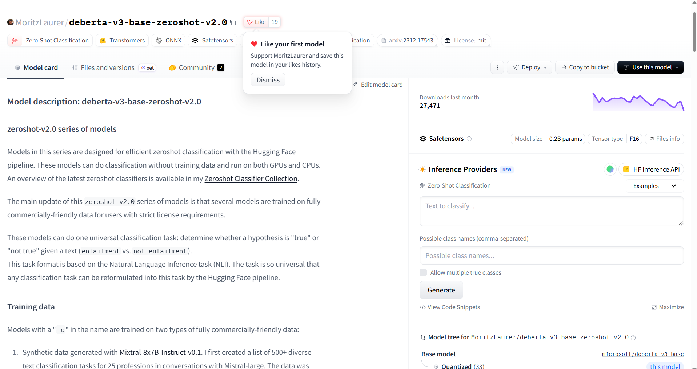
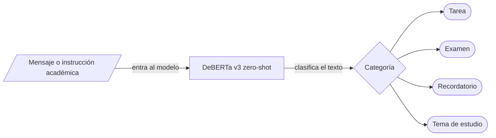

# ClassMate AI: Organizador académico inteligente

## Descripción del proyecto

ClassMate AI es una herramienta de inteligencia artificial que ayuda a estudiantes universitarios a **organizar su información académica**. Recibe textos como instrucciones de profesores, avisos de clase y pendientes escolares, y los clasifica en categorías:

- Tareas
- Exámenes
- Recordatorios
- Temas de estudio

## Equipo

| Nombre completo | Papel en el proyecto |
|:---|:---|
| Mariano Hernández Antuñano | Caso de uso, riesgos éticos, edición del README y estructura del repositorio |
| Javier Emilio Aranda Espinoza | Investigación y revisión de documentación |
| Alexa González Del Castillo Torres | Investigación, organización y documentación del proyecto |
| Paola Bocanegra Téllez | README, correcciones y organización del proyecto |

## Modelo abierto elegido

| Dato | Respuesta |
|:---|:---|
| Identificador | `MoritzLaurer/deberta-v3-base-zeroshot-v2.0` |
| Tarea (pipeline tag) | `zero-shot-classification` |
| Parámetros | Aproximadamente 200 millones |
| Licencia | MIT |
| Model Card | [Ver en Hugging Face](https://huggingface.co/MoritzLaurer/deberta-v3-base-zeroshot-v2.0) |

## Infraestructura

Para estimar la memoria necesaria para guardar los pesos del modelo se usa una precisión de 16 bits, es decir, 2 bytes por parámetro:

$$
\text{Memoria} = 200{,}000{,}000 \times 2 = 400{,}000{,}000 \text{ bytes} \approx 400 \text{ MB} \approx 0.4 \text{ GB}
$$

Es solo una estimación de los pesos; no incluye la memoria adicional que se usa al ejecutar el modelo.

El modelo se ejecutará inicialmente en **Google Colab con GPU**.

## 🔀 Cómo funciona

El proyecto usa el modelo **MoritzLaurer/deberta-v3-base-zeroshot-v2.0**: entra un texto académico, el modelo lo clasifica y sale la categoría sugerida.
